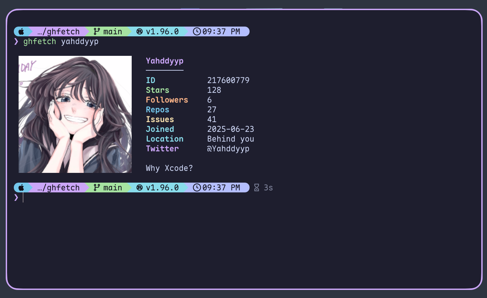

# Ghfetch

Ghfetch is a neofetch/fastfetch like tool for fetching GitHub stats from different profiles and displaying it in a beautiful way.



## Installation

### Requirements

- A terminal that supports kitty's image rendering protocol (eg: ghostty or kitty).

#### Homebrew

```bash
brew install Yahddyyp/tap/ghfetch
```

#### From source

```bash
git clone https://github.com/Yahddyyp/ghfetch.git
cd ghfetch
cargo build --release
```

The binary will be available at:

```
target/release/ghfetch
```

## Usage

```bash
ghfetch <username>
```

For example:

```bash
ghfetch yahddyyp
```

### Github Token

`ghfetch` works without authentication, but GitHub's API has stricter
rate limits for unauthenticated requests.

You can provide a GitHub **Personal Access Token** through:

```bash
export GHFETCH_TOKEN="your_token"
```

Even if you don't have the `GHFETCH_TOKEN` set, it will check for `gh auth token` and `GITHUB_TOKEN` as well to authenticate requests.

### Configuration

The configuration file is located at:

```
~/.config/ghfetch/config.toml
```

You can customize which fields are displayed in what order:

```toml
fields = [
  "user",
  { underline = "user" }, # Can take a field or a numeric value
  "id",
  "stars",
  "prs",
  "followers",
  "following",
  "repos",
  "issues",
  "joined",
  "language",
  "company",
  "location",
  "twitter",
  "blog",
  { break_if = "bio" },
  "bio",
  "break",
  # Supports ANSI escape sequences (use TOML's \u001b escape sequences) and field substituions like {user}
  { text = "Built with \u001b[38;2;255;127;42mRust\u001b[0m 🦀" }
]
```

Colors can be by customized:

```toml
[colors]
user = { r = 203, g = 166, b = 247 }
# Uses the terminal's default foreground color if omitted
# underline = { r = 255, g = 255, b = 255 }
id = { r = 137, g = 220, b = 235 }
stars = { r = 166, g = 227, b = 161 }
prs = { r = 137, g = 220, b = 235 }
followers = { r = 250, g = 179, b = 135 }
following = { r = 180, g = 190, b = 254 }
repos = { r = 116, g = 199, b = 236 }
issues = {r = 249, g = 226, b = 175}
joined = { r = 137, g = 220, b = 235 }
language = { r = 203, g = 166, b = 247 }
company = { r = 250, g = 179, b = 135 }
location = { r = 137, g = 220, b = 235 }
twitter = { r = 203, g = 166, b = 247 }
blog = { r = 203, g = 166, b = 247 }
```

And customise how the image appears:

```toml
[image]
image_columns = 24
image_rows = 12
left_gap = 1
right_gap = 3
```

<p align="center"><a href="https://github.com/yahddyyp/ghfetch/blob/main/LICENSE"></a></p>
